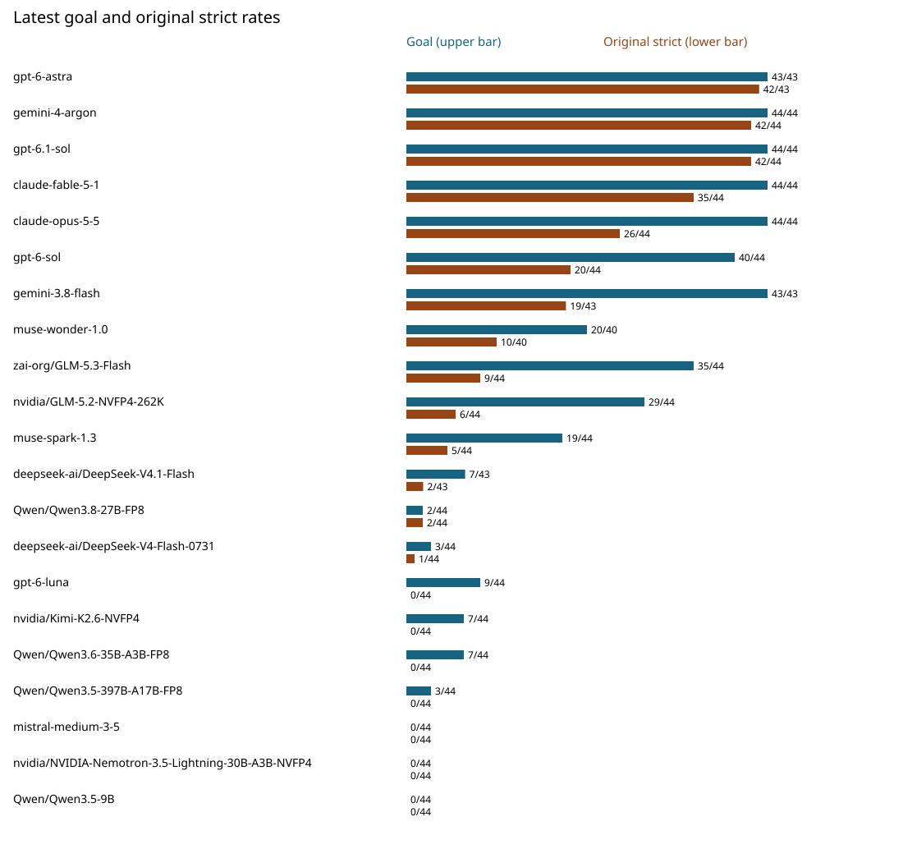
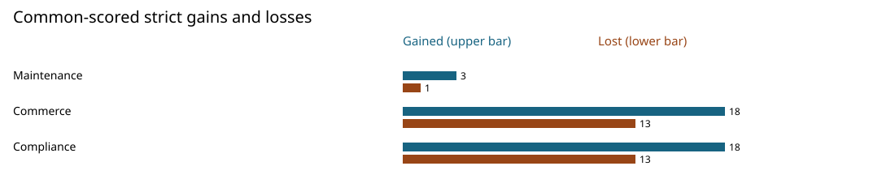

# Achieving the outcome is not the same as running the operation well

An agent can finish the intended workflow while making a decision that should have been avoided. In these exploratory synthetic observations, the latest series records 443 goal achievements among 917 scored cases, but only 261 original strict passes. “Strict” means passing all reported quality checks, not simply reaching the goal. The difference makes the trajectory worth examining alongside the outcome. It does not establish that every failed check caused harm, or that every stored pass was free of refused actions.

This study describes 21 exact model IDs across two owner-run series. Each model was assigned 44 related synthetic cases: three Maintenance, 16 Commerce and 25 Compliance. There was one trial per case per series. Historical and repeat observations used different evaluator/runtime versions, adapters and settings. They are not a same-condition statistical replication, evidence of model learning, or a validated capability ranking. The repeat is dated 2026-10-24; historical observations span source cohorts.

## Outcomes and original reported checks

The historical series has 916 scored cases, four excluded and four aborted; the repeat has 917 scored and seven excluded, out of 924 assignments each. Historical goals and strict passes were 451 and 250. These totals describe each series separately. Exclusions and aborts receive no inferred grade. All rates use scored denominators; costs are not published (null), never zero.

Original grades are displayed. The known Compliance terminal read-guard omission and the separate diagnostic measured below affect some stored strict passes.



*Figure 1. Upper blue bars show goal achievement, lower brown bars original strict passes, on a 0–100% scale. The table is the full text alternative. These are original grades, before the separate Compliance diagnostic.*

The table sorts by exact latest strict/scored fraction descending, then goal/scored descending, then casefolded and exact ID. This is a reading order, not an official ranking. Historical cells give goal count and strict count with their shared scored denominator. Latest decision counts cover scored Core decisions only, not generation RPCs or all attempted calls; they do not measure cost or efficiency. Full historical dispositions are in the aggregate CSV.

| Exact model ID | Historical goal; strict / scored | Latest goal / scored | Latest original strict / scored | Latest excluded | Latest scored Core decisions |
|---|---:|---:|---:|---:|---:|
| `gpt-6-astra` | 44; 42 / 44 | 43/43 | 42/43 | 1 | 804 |
| `gemini-4-argon` | 44; 42 / 44 | 44/44 | 42/44 | 0 | 757 |
| `gpt-6.1-sol` | 44; 42 / 44 | 44/44 | 42/44 | 0 | 829 |
| `claude-fable-5-1` | 43; 35 / 43 | 44/44 | 35/44 | 0 | 853 |
| `claude-opus-5-5` | 43; 22 / 44 | 44/44 | 26/44 | 0 | 845 |
| `gpt-6-sol` | 39; 19 / 44 | 40/44 | 20/44 | 0 | 1187 |
| `gemini-3.8-flash` | 43; 20 / 43 | 43/43 | 19/43 | 1 | 697 |
| `muse-wonder-1.0` | 27; 12 / 43 | 20/40 | 10/40 | 4 | 901 |
| `zai-org/GLM-5.3-Flash` | 33; 4 / 44 | 35/44 | 9/44 | 0 | 1316 |
| `nvidia/GLM-5.2-NVFP4-262K` | 34; 6 / 44 | 29/44 | 6/44 | 0 | 1796 |
| `muse-spark-1.3` | 18; 4 / 44 | 19/44 | 5/44 | 0 | 1119 |
| `deepseek-ai/DeepSeek-V4.1-Flash` | 9; 0 / 44 | 7/43 | 2/43 | 1 | 2930 |
| `Qwen/Qwen3.8-27B-FP8` | 1; 1 / 44 | 2/44 | 2/44 | 0 | 2608 |
| `deepseek-ai/DeepSeek-V4-Flash-0731` | 2; 1 / 44 | 3/44 | 1/44 | 0 | 2523 |
| `gpt-6-luna` | 9; 0 / 40 | 9/44 | 0/44 | 0 | 2432 |
| `nvidia/Kimi-K2.6-NVFP4` | 7; 0 / 43 | 7/44 | 0/44 | 0 | 1190 |
| `Qwen/Qwen3.6-35B-A3B-FP8` | 8; 0 / 44 | 7/44 | 0/44 | 0 | 1845 |
| `Qwen/Qwen3.5-397B-A17B-FP8` | 3; 0 / 44 | 3/44 | 0/44 | 0 | 1352 |
| `mistral-medium-3-5` | 0; 0 / 44 | 0/44 | 0/44 | 0 | 2403 |
| `nvidia/NVIDIA-Nemotron-3.5-Lightning-30B-A3B-NVFP4` | 0; 0 / 44 | 0/44 | 0/44 | 0 | 2246 |
| `Qwen/Qwen3.5-9B` | 0; 0 / 44 | 0/44 | 0/44 | 0 | 1226 |

A goal count alone also hides variation within a row. For example, `gpt-6-luna` reaches nine goals out of 44 scored cases in the repeat, yet has no original strict passes. That does not tell us which check prevented each pass, whether an action was blocked, or whether recovery occurred. Those questions require examining trajectories and evaluator semantics. Conversely, a high strict fraction describes these assigned cases under their reported checks; it supplies no estimate for a different workload, deployment environment or number of repeated attempts.

## Equal scores can conceal different passed cases

Among the 910 model–case pairs scored in both series, 66 changed strict status: 39 gained a pass and 27 lost one. In 61 of those 66, the goal was true in both series. The other five comprise three goal losses and two goal gains. Thus 61 strict-status changes had no goal-status change. These counts alone do not distinguish agent behavior from evaluator, runtime, adapter or settings differences, identify blocked proposals, or prove harm. The inspected semantic examples below provide separate evidence.

`gemini-4-argon` stayed at 42 total strict passes with one gained case and one lost case (41 retained cases); `gpt-6.1-sol` stayed at 42 with two gains and two losses (40 retained cases). `gpt-6-sol` moved from 19 to 20 with seven gains and six losses. Those are common-scored comparisons, not pooled episodes or repeated estimates of a stable underlying success probability. A small net change can hide substantial case churn.



*Figure 2. Counts on common-scored pairs only: 39 gains and 27 losses. The following flow table supplies denominators. These are descriptive transitions, without confidence intervals or significance claims.*

| Flow (cases/model) | Historical goal; strict / scored | Repeat goal; strict / scored | Historical excluded; aborted | Repeat excluded | Common scored | Strict gained; lost |
|---|---:|---:|---:|---:|---:|---:|
| Maintenance (3) | 24; 11 / 59 | 22; 11 / 60 | 1; 3 | 3 | 57 | 3; 1 |
| Commerce (16) | 206; 118 / 334 | 209; 124 / 336 | 1; 1 | 0 | 334 | 18; 13 |
| Compliance (25) | 221; 121 / 523 | 212; 126 / 521 | 2; 0 | 4 | 519 | 18; 13 |

The case mix matters: Compliance contributes 25 of 44 assignments per model, Commerce 16 and Maintenance three. Aggregate rates therefore reflect these weights, rather than an equal balance of flows. The public 63-row model-by-flow CSV makes individual flow differences inspectable without treating related variants as independent tasks.

## What the trajectories illustrate

The following semantic summaries come from AI-assisted maintainer review of owner-retained traces, not independent human semantic validation. Raw trajectories remain private; no provider wording or trace-level proof is supplied here.

For Opus in Commerce UK_NORMAL, both series complete a single synthetic GBP105 refund. The historical case passed strict checks; the repeat did not. The repeat resubmits an already accepted `decide_entitlement`, receives `DUPLICATE_ENTITLEMENT`, corrects the mistake and completes. That rejected duplicate decision is not a duplicate payment. The example separates a recovered operational error from the successful refund. It cannot by itself establish real-world financial harm.

For Argon in Maintenance V1, a historical premature COMPLETE attempt is refused while the simulated customer still reports persistence. Both versions ultimately complete the intended workflow, and the repeat avoids that attempt. In the repeat AU_remediation case, however, a send payload missing a recipient is rejected before recovery. This helps explain how 42→42 can contain changed faults. It is a synthetic workflow, not an actual customer interaction or certification.

For GLM5.3 in Compliance SC_qualification and NZ_qualification, saved repeat strict passes include a stale COMPLETE refusal, a fresh reread and legitimate referral completion. Runtime protection worked, but the original evaluator omitted the terminal read-guard fault. The diagnostic below records a retrieval failure. A referral does not certify property compliance. This limits interpretation of the earlier full-cohort original reported strict-count increase from 4→9; it does not show that all study results are invalid.

## Separate Compliance correction diagnostic

The offline diagnostic covers all 1,044 scored Compliance records, with original-baseline parity on all 1,044. There were 35 stale terminal attempts (18 historical, 17 repeat). Findings and retrieval change on 23 records (12 historical, 11 repeat); 11 stored strict passes become diagnostic strict failures (five historical, six repeat). Goals and the other ten dimensions remain unchanged. Attempts, changed records and changed passes are different units.

| Series | Exact model ID | Original strict → diagnostic strict / Compliance scored |
|---|---|---:|
| Repeat | `gemini-3.8-flash` | 7 → 3 / 24 |
| Repeat | `zai-org/GLM-5.3-Flash` | 4 → 2 / 25 |
| Historical | `gemini-3.8-flash` | 10 → 6 / 24 |
| Historical | `zai-org/GLM-5.3-Flash` | 1 → 0 / 25 |

These four rows use **Compliance denominators**, not full 44-case corrected model totals. Across Compliance, original strict counts of 121/523 and 126/521 become diagnostic 116/523 and 120/521. Headline grades above remain original. Other flows were not reevaluated. This is an offline saved-record diagnostic, not authenticated replay, an official regrade or a new model run.

The correction is a separate [candidate in PR #37](https://github.com/DwellyOrg/OperateBench/pull/37), not a claim of merged main behavior. Candidate evaluator version: 0.3.0; evaluator source SHA-256: `4899ba74ff12e798306b9b85492444272b36f2d03254a1ff3ca6be6c9654bee9`. Its terminal handling change is bounded; the unmapped terminal-claim code policy is unchanged.

## Methodology, reproducibility and limits

[Aggregate JSON](2026-10-aggregates.json), [21-model CSV](2026-10-models.csv), [63 model–flow rows](2026-10-model-flows.csv) and [42 Compliance model–series diagnostic rows](2026-10-compliance-diagnostic.csv) support recomputing the fractions, order, flow totals and charts. CSV empty cost fields represent JSON null. JSON `old` means historical; `new` means repeat. `common_*` fields restrict comparisons to cases scored in both series; `strict_gained` and `strict_lost` count paired transitions. Diagnostic `reliable` fields mean strict passes, not goal completions. The JSON cross-tab supplies goal status within strict flips.

Public code and the correction PR support inspection of evaluator logic and deterministic reference/negative controls. Existing offline Maintenance commands, run from the repository with its dependencies installed, are:

```sh
operatebench run --pack maintenance --spec examples/operatebench/maintenance_v0_1.yaml --scenario V1 --agent reference --output v1_reference.json
operatebench replay --pack maintenance --spec examples/operatebench/maintenance_v0_1.yaml --run v1_reference.json
operatebench check --pack maintenance --spec examples/operatebench/maintenance_v0_1.yaml
```

These exercise reference behavior and targeted negative controls; they do not reproduce the paid model study. Owner-retained raw records and trajectories are not released. An outsider cannot fully reproduce the historical study from aggregates alone. No independent human semantic validation or provider attestation is claimed.

Official Lifecycle scope remains **one Maintenance Semantic Scenario with three variants**. Commerce and Compliance are SDK incubators, not additional admitted official tracks. Related synthetic cases do not establish legal validity, production safety or deployment performance. This report makes no official Lifecycle model ranking, novelty, competitor or superiority claim. The [preserved historical 19-model table](../MODEL_RESULTS.md) and [results preview](https://dwellyorg.github.io/operatebench-results-preview/) provide complementary source context.

Content and aggregate data: © 2026 Prospire Technologies Ltd, CC BY 4.0; see [LICENSE-DATA](../../LICENSE-DATA). Original ownership and attribution are retained.
